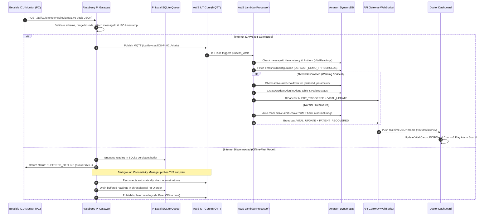

# System Architecture Specification
## Real-Time IoT-Based ICU Patient Monitoring System (ICUGuardian)

> **ACADEMIC PROTOTYPE DISCLAIMER:** This system is an engineering demonstration prototype designed for live college presentation. Simulated patient vital signs and configurable demo thresholds must never be used for clinical diagnosis or patient treatment.

---

## 1. High-Level System Architecture

The system implements a resilient, end-to-end IoT-to-Cloud pipeline with **Offline-First Edge Buffering** and **Dual-Mode Cloud Connectivity** (supporting AWS IoT Core + Serverless Backend as well as a Local Cloud Emulator / FastAPI WebSocket Bridge so live college demonstrations work reliably even on restricted campus Wi-Fi).

```mermaid
flowchart LR
    subgraph Bedside["1. Bedside ICU Environment (PC)"]
        SimUI["Bedside Patient Monitor UI\n(React + TypeScript + ECG Canvas)"]
        SimEngine["Patient Vital Simulator\n(7 Clinical Demo Scenarios)"]
        Sensors["Optional Hardware Sensors\n(MAX30102, DS18B20, AD8232)"]
        SimEngine --> SimUI
    end

    subgraph Edge["2. Raspberry Pi IoT Gateway (Python)"]
        Receiver["Simulator Receiver (HTTP/WS)\n& Sensor Manager (I2C/SPI)"]
        Validator["Data Processor & Validator\n(Schema + Outlier Filtering)"]
        SQLiteQueue["Offline Persistent Queue\n(SQLite WAL Buffer)"]
        MQTTClient["AWS IoT MQTT Client\n(TLSv1.2 X.509 Mutual Auth)"]

        Receiver --> Validator
        Validator --> MQTTClient
        Validator -. "Offline Fallback" .-> SQLiteQueue
        SQLiteQueue -. "Auto-Sync on Reconnect" .-> MQTTClient
    end

    subgraph AWS["3. AWS Cloud Infrastructure"]
        IoTCore["AWS IoT Core\n(MQTT Broker)"]
        IoTRules["AWS IoT Rules Engine\n(Topic Routing)"]
        LambdaVitals["Lambda: process_vitals\n(Validation & Threshold Engine)"]
        LambdaAlerts["Lambda: process_alerts\n(Cooldown, Dedup, Recovery)"]
        LambdaStatus["Lambda: device_status\n(LWT & Heartbeat Monitor)"]
        DynamoDB[("Amazon DynamoDB\n6 Tables + GSIs")]
        APIGW["Amazon API Gateway\n(REST API + WebSocket API)"]

        IoTCore --> IoTRules
        IoTRules --> LambdaVitals
        IoTRules --> LambdaStatus
        LambdaVitals --> DynamoDB
        LambdaVitals --> LambdaAlerts
        LambdaAlerts --> DynamoDB
        LambdaVitals --> APIGW
        LambdaAlerts --> APIGW
        LambdaStatus --> APIGW
    end

    subgraph Client["4. Doctor Web Application (ICUGuardian)"]
        DocUI["Doctor / Nurse / Admin Portal\n(React + TypeScript + Tailwind + Recharts)"]
        AudioAlert["Web Audio Synthesizer\n(Critical & Warning Alarms)"]
        DocUI --> AudioAlert
    end

    SimUI -- "Local Network HTTP/WS\n(JSON Telemetry @ 1Hz)" --> Receiver
    Sensors -. "Hardware Mode" .-> Receiver
    MQTTClient -- "MQTT over TLS (Port 8883)\nicu/devices/{deviceId}/vitals" --> IoTCore
    APIGW -- "WSS Real-Time Push +\nREST Historical Queries" --> DocUI
```

---

## 2. End-to-End Real-Time Data Flow Sequence

---

## 3. MQTT Topic Specification

All MQTT communication between Raspberry Pi gateways and AWS IoT Core uses **MQTT v3.1.1 / v5.0 over TLS v1.2 (Port 8883)** with X.509 client certificates.

| Topic Pattern | Direction | QoS | Purpose |
|---|---|---|---|
| `icu/devices/{deviceId}/vitals` | Pi → AWS | QoS 1 | Continuous vital sign telemetry (1 Hz default) including ECG samples |
| `icu/devices/{deviceId}/status` | Pi → AWS | QoS 1 | Device heartbeat, IP, mode (`SIMULATION`/`HARDWARE`), offline queue depth, and MQTT Last Will & Testament (LWT) |
| `icu/patients/{patientId}/alerts` | AWS → Pi / Subscribers | QoS 1 | Real-time alert events published when thresholds are crossed |
| `icu/devices/{deviceId}/commands` | AWS → Pi | QoS 1 | Remote commands from Admin/Doctor Dashboard (e.g., mode switch, threshold sync, diagnostics ping) |

---

## 4. Component Responsibilities & Hybrid Demonstration Architecture

To guarantee **100% reliability during a live college presentation**, the system is engineered with a clean modular boundary:

1. **Bedside ICU Patient Monitor (`patient-monitor-pc`)**
   - Dark medical-grade bedside monitor interface displaying real-time sweeping ECG waveform, Heart Rate, SpO2, Blood Pressure, Temperature, and Respiratory Rate.
   - Interactive **Scenario Controller** supporting all required presentation scenarios:
     1. `NORMAL` (Normal sinus rhythm, HR ~72, SpO2 ~98%, Temp ~36.7°C, RR ~16, BP 120/80)
     2. `HIGH_HR` (Tachycardia: HR 125–138 BPM)
     3. `LOW_SPO2` (Hypoxemia: SpO2 drops to 86–89%)
     4. `HIGH_TEMP` (Hyperpyrexia: Temp rises to 39.2°C)
     5. `ABNORMAL_RR` (Tachypnea/Bradypnea: RR 29 breaths/min)
     6. `CRITICAL` (Multi-parameter crisis: HR 135, SpO2 85%, Temp 39.4°C, RR 30, BP 88/54)
     7. `RECOVERY` (Smooth physiological transition back to normal baseline)

2. **Raspberry Pi IoT Gateway (`raspberry-pi-gateway`)**
   - Runs on Raspberry Pi (or any Linux host) in `SIMULATION` mode (receiving bedside PC telemetry over LAN HTTP/MQTT) or `HARDWARE` mode (reading physical sensors via `sensor_manager.py`).
   - Validates payloads against `vitals.schema.json`, filters spikes/NaNs, attaches `messageId` and `deviceId`, and publishes to AWS IoT Core (and/or the local cloud backend).
   - Includes a **Network Disconnection Simulator toggle** so the presenter can demonstrate **DEMO 5 (Internet Disconnection & Offline Queue Sync)** with a single click or command without unplugging Ethernet/Wi-Fi on stage.

3. **AWS Cloud Infrastructure & Local Cloud Bridge (`aws-cloud`)**
   - Full AWS Serverless implementation: IoT Core Policies & Rules, 5 Python Lambda handlers (`process_vitals`, `process_alerts`, `device_status`, `api_handler`, `websocket_handler`), DynamoDB table definitions, and CloudFormation/SAM + Boto3 deployment scripts.
   - Also includes a unified **FastAPI Cloud Backend Server** that runs the exact same validation, alert engine, cooldown/recovery logic, REST APIs, and WebSocket push locally or in the cloud, with automatic DynamoDB or SQLite/In-Memory persistence.

4. **Doctor Web Application (`doctor-dashboard` — "ICUGuardian")**
   - Built with React, TypeScript, Tailwind CSS, Lucide Icons, and Recharts, faithfully implementing the **ICUGuardian** design system (`Design/` folder) while fulfilling every PRD requirement:
     - **Role-Based Sign In** (Doctor, Nurse, Admin + Quick Demo Access buttons)
     - **ICU Live Dashboard** (Summary KPI cards, Search/Filter/Sort by Bed, Live Patient Overview table + Card grid view, real-time status badges)
     - **Individual Patient Monitoring Page** (Live Vital Cards for HR, SpO2, BP, Temp, RR; Real-Time ECG Waveform Monitor; Interactive Trend Tabs for HR, SpO2, BP, Temp, RR with 1h/6h/24h/Custom ranges; Patient Clinical Info sidebar with Allergies & Medications; Export & Alerts toggle)
     - **Alert Management Center** (KPI counters, Acknowledge All, Search & Category/Severity/Status filters, Priority-ordered Alert History table with Acknowledge & Resolve lifecycle buttons, Web Audio critical alarm synthesizer)
     - **Report Generator** (HIPAA-styled report builder with patient selector, date range, report type, section checkboxes, live report preview, and downloadable export)
     - **User Management** (Admin view: Staff accounts, roles, departments, status toggles, Add User modal)
     - **Device Management** (Admin view: Raspberry Pi Monitor Hubs, IP addresses, uptime, firmware, tabs for Device Overview, System Health, Network Status, Diagnostics, plus offline simulation trigger)
     - **Settings** (5 Tabs: Alert Thresholds with live backend sync, Notifications & Sound volume, Appearance, Privacy & Security, System)
     - **Help & Support** (4 Tabs: FAQ accordions, Contact Support & Submit Ticket form, My Tickets list, Documentation & Resources)
