# Complete Physical Hardware Setup & Production Deployment Guide
## Real-Time ICU Patient Monitoring System (Bedside ICU Monitor → Ethernet LAN → Raspberry Pi → AWS Cloud → Worldwide Doctor Mobile App)

---

## 1. End-to-End Physical System Architecture

In a real-world clinical engineering deployment, the **Raspberry Pi** operates as a **Dual-Homed Edge IoT Gateway** with strict network segmentation between the bedside medical device interface and the upstream internet interface:

```mermaid
flowchart LR
    subgraph Bedside["Bedside Isolation Zone (VLAN / Point-to-Point LAN)"]
        Monitor["Physical ICU Patient Monitor\n(Mindray / Philips / Nihon Kohden / Dräger)\nStatic IP: 192.168.50.10/24"]
        Isolator["IEC 60601-1 Medical Ethernet\nGalvanic Isolator (4 kV)"]
        Monitor -- "Cat6 Patch Cable" --> Isolator
    end

    subgraph Gateway["Raspberry Pi 4B / 5 Bedside Gateway"]
        Eth0["eth0 (Onboard RJ45)\nStatic IP: 192.168.50.1/24\nNo Default Gateway"]
        HL7Daemon["icu_monitor_lan_driver.py\n(HL7 v2.6 MLLP / IHE PCD-01\nTCP Port 2575 + ISO/IEEE 11073 MDC)"]
        Processor["data_processor.py\n(Validation & Edge Thresholds)"]
        SQLiteWAL[("offline_queue.db\nSQLite WAL Store-and-Forward")]
        MQTTClient["mqtt_client.py\n(MQTT v3.1.1 over TLS v1.2\nX.509 Mutual Auth)"]
        Wlan0["wlan0 / eth1 (Upstream NIC)\nHospital IoT Wi-Fi / 4G LTE\nDHCP + Default Route"]

        Isolator -- "Cat6 Cable" --> Eth0
        Eth0 --> HL7Daemon
        HL7Daemon --> Processor
        Processor --> MQTTClient
        Processor -. "Network Outage" .-> SQLiteWAL
        SQLiteWAL -. "FIFO Drain on Reconnect" .-> MQTTClient
        MQTTClient --> Wlan0
    end

    subgraph AWS["AWS Cloud Infrastructure (Worldwide Access)"]
        IoTCore["AWS IoT Core\n(Port 8883 mTLS)\nicu/devices/{deviceId}/vitals"]
        IoTRules["AWS IoT Rules Engine"]
        LambdaVitals["AWS Lambda: ICU_ProcessVitalsLambda\n& ICU_ProcessAlertsLambda"]
        DynamoDB[("Amazon DynamoDB\nICU_Patients, ICU_VitalReadings,\nICU_Alerts, ICU_Devices")]
        APIGW["Amazon API Gateway\n(REST API + WebSocket WSS API)"]
        CloudFront["AWS CloudFront + S3\n(HTTPS Global Hosting)"]

        Wlan0 -- "TLS 1.2 (Port 8883)" --> IoTCore
        IoTCore --> IoTRules
        IoTRules --> LambdaVitals
        LambdaVitals --> DynamoDB
        LambdaVitals --> APIGW
        DynamoDB <--> APIGW
    end

    subgraph Mobile["Doctor Mobile Application (Worldwide 4G/5G/Wi-Fi)"]
        Phone["Doctor Smartphone (iOS / Android)\nInstalled PWA / Mobile Client"]
        CloudFront -- "HTTPS App Bundle" --> Phone
        APIGW <== "WSS Real-Time Push +\nHTTPS REST + JWT Auth" ==> Phone
    end
```



---

## 2. Required Hardware Components, Cables & Specifications

| Item | Specification / Recommended Hardware | Purpose |
|---|---|---|
| **1. Bedside ICU Patient Monitor** | Mindray BeneVision (N-Series / ePM / uMEC), Philips IntelliVue (MX/MP Series with LAN/MIB export), Dräger Infinity / Vista 120, Nihon Kohden Life Scope, or Contec CMS8000/CMS9000 with **RJ45 Ethernet HL7 / Data Export option** | Acquires real-time ECG, SpO₂, NIBP/IBP, Core Temp, and Resp Rate from patient probes |
| **2. Raspberry Pi Gateway** | **Raspberry Pi 4 Model B (4 GB / 8 GB RAM)** or **Raspberry Pi 5** | Dual-interface edge gateway (`eth0` for monitor LAN, `wlan0` or USB `eth1` for cloud uplink) |
| **3. Medical Ethernet Isolator** | **IEC 60601-1 Certified RJ45 Network Isolator** (e.g., Baaske MED MI 1005, 4 kV dielectric isolation, 100/1000BASE-T) | **Mandatory for patient electrical safety:** prevents leakage current loops between the Raspberry Pi and patient-connected monitor |
| **4. Storage Media** | Industrial High-Endurance microSD Card (32 GB / 64 GB, Class A2) or NVMe SSD HAT | Prevents SD wear during continuous 24/7 SQLite WAL offline buffering and logging |
| **5. Ethernet Cables** | 2 × Cat6 Shielded (STP) RJ45 Patch Cables (0.5m and 2m) | Connects Monitor RJ45 → Medical Isolator → Raspberry Pi `eth0` |
| **6. Power Supply & UPS** | Official 5V/3A (Pi 4) or 5V/5A (Pi 5) USB-C Power Supply + **Uninterruptible Power Supply (UPS HAT, e.g., Geekworm X728 / PiSugar)** | Keeps Raspberry Pi running and buffering vitals during bedside mains power transfer |
| **7. Upstream Internet Interface** | Built-in Dual-Band Wi-Fi (`wlan0` 802.11ac) OR USB 3.0 Gigabit Ethernet Adapter (`eth1`) / 4G LTE Cellular Modem | Connects Raspberry Pi to AWS IoT Core over TLS port 8883 |

---

## 3. ICU Monitor Communication Protocols & Manufacturer Matrix

**Crucial Engineering Fact:** Not every ICU patient monitor speaks the same protocol on its RJ45 Ethernet port. Before writing network rules, identify which protocol family your specific ICU monitor uses:

| Manufacturer / Series | Ethernet Protocol | Transport & Default Port | Framing & Data Format | How to Enable on the Monitor |
|---|---|---|---|---|
| **Mindray** (BeneVision N-Series, ePM, uMEC, iMEC) | **HL7 v2.4 / v2.6 MLLP** (`ORU^R01` IHE PCD-01) | TCP Client (pushes to Gateway IP) or TCP Server on Port **`2575`** or **`6661`** | MLLP (`0x0B` + HL7 ASCII segments + `0x1C 0x0D`) with ISO/IEEE 11073 MDC codes | `Main Menu → Maintenance → User Maintenance (password) → Network → HL7 Configuration`: Set Destination IP = `192.168.50.1`, Port = `2575`, Interval = `1s`, Send Waveforms = `ON` |
| **Dräger** (Vista 120 / Infinity Delta) | **HL7 v2.x MLLP** | TCP Client pushing to **`2575`** | MLLP HL7 `ORU^R01` (`MSH`, `PID`, `PV1`, `OBR`, `OBX`) | `System Setup → Network Setup → HL7`: Set Local IP = `192.168.50.10`, Host IP = `192.168.50.1`, Port = `2575` |
| **Nihon Kohden** (Life Scope BSM) | **HL7 v2.x MLLP** | TCP Port **`2575`** | MLLP HL7 `ORU^R01` | Configure HL7 output destination IP to `192.168.50.1:2575` |
| **Philips** (IntelliVue MP30–MP90 / MX400–MX800) | **1.** Via IntelliBridge / PII: **HL7 IHE PCD-01 MLLP**<br>**2.** Direct LAN port: **Philips Data Export Protocol (MDDL / IEEE 11073)** | **1.** TCP Port **`2575`**<br>**2.** UDP/TCP Port **`24105`** | **1.** MLLP HL7 `ORU^R01`<br>**2.** Binary ROapdu / Association Request + Extended Poll Data Request | `Service Mode → LAN Config`: Set IP manually (`192.168.50.10`) or use BootP |
| **GE Healthcare** (CARESCAPE B450/B650/B850) | **HL7 v2.6 MLLP** (via CARESCAPE Gateway) or **Datex-Ohmeda S/5 Collect** | TCP Port **`2575`** (HL7) | MLLP HL7 `ORU^R01` | Service Menu → Network → HL7 Outbound Stream |

> **Implemented in This Codebase:** `raspberry-pi-gateway/icu_monitor_lan_driver.py` implements a production **HL7 v2.x MLLP TCP Listener & Parser** on port `2575` with full **ISO/IEEE 11073-10101 MDC** and **LOINC** code mapping (`147842` Heart Rate, `150456` SpO₂, `150344` Temp, `151562` Resp Rate, `150021`/`150022` NIBP/IBP Systolic/Diastolic, `131329` Lead II ECG waveform arrays) and automatic `ACK^R01` replies.

---

## 4. Step-by-Step Physical Connection & Raspberry Pi Network Setup

### Step 4.1: Physical Ethernet Wiring (Point-to-Point Isolated Subnet)
1. Plug one Cat6 patch cable into the **RJ45 LAN port** on the back of the ICU Patient Monitor.
2. Connect that cable into the **Equipment side** of the **IEC 60601-1 Medical Ethernet Isolator**.
3. Connect the second Cat6 patch cable from the **Gateway side** of the isolator into the **Raspberry Pi `eth0` RJ45 port** (Modern Gigabit Ethernet ports support Auto-MDI/MDIX, so a crossover cable is not required).

### Step 4.2: Configure Dual-NIC Networking on Raspberry Pi OS (Bookworm / NetworkManager)
We assign a dedicated static IP (`192.168.50.1/24`) to `eth0` **without a default gateway** so all internet traffic (`0.0.0.0/0`) routes exclusively through `wlan0` (Wi-Fi) or `eth1` (USB Ethernet):

```bash
# 1. Configure eth0 for the private ICU Monitor LAN (192.168.50.1/24)
sudo nmcli connection add type ethernet con-name icu-monitor-lan ifname eth0 \
  ipv4.method manual \
  ipv4.addresses 192.168.50.1/24 \
  ipv4.never-default yes \
  ipv6.method ignore \
  connection.autoconnect yes

sudo nmcli connection up icu-monitor-lan

# 2. Connect wlan0 to Hospital Internet Wi-Fi for AWS Cloud access
sudo nmcli device wifi connect "<HOSPITAL_IOT_WIFI_SSID>" password "<WIFI_PASSWORD>"

# 3. Verify routing table (default route MUST be via wlan0, 192.168.50.0/24 via eth0)
ip route show
```

Expected output of `ip route show`:
```text
default via 10.10.0.1 dev wlan0 proto dhcp src 10.10.0.45 metric 600
192.168.50.0/24 dev eth0 proto kernel scope link src 192.168.50.1 metric 100
```

### Step 4.3: Lock Down Raspberry Pi Firewall (Prevent Bridging Medical Device to Internet)
```bash
# Disable IPv4 packet forwarding between eth0 and wlan0
sudo sysctl -w net.ipv4.ip_forward=0
echo "net.ipv4.ip_forward=0" | sudo tee -a /etc/sysctl.conf

# Allow HL7 MLLP (TCP 2575) and local telemetry (TCP 5050) ONLY on eth0 and loopback
sudo ufw default deny incoming
sudo ufw default allow outgoing
sudo ufw allow in on eth0 from 192.168.50.0/24 to 192.168.50.1 port 2575 proto tcp
sudo ufw allow in on lo
sudo ufw allow ssh
sudo ufw enable
```

### Step 4.4: Configure the ICU Patient Monitor Network Settings
On the ICU Patient Monitor touchscreen:
1. Open **Menu → Maintenance → User Maintenance → Network Setup**.
2. Set **Monitor IP Address Mode**: `Static / Manual`
   - **IP Address:** `192.168.50.10`
   - **Subnet Mask:** `255.255.255.0`
   - **Default Gateway:** `192.168.50.1`
3. Open **HL7 / Data Export Setup**:
   - **Protocol:** `HL7 v2.6 MLLP` (or `IHE PCD-01`)
   - **Destination / Host IP:** `192.168.50.1`
   - **Destination Port:** `2575`
   - **Real-Time Vital Interval:** `1 sec` (or `5 sec`)
   - **Send Real-Time Waveforms / Alarms:** `Enabled`

### Step 4.5: Verify Physical Link & Packet Reception on Raspberry Pi
```bash
# 1. Verify Ethernet physical carrier link and ARP resolution
ethtool eth0 | grep "Link detected"
ping -c 3 192.168.50.10

# 2. Inspect incoming HL7 MLLP packets on eth0 port 2575
sudo tcpdump -i eth0 -nn -A tcp port 2575 -c 5
```

---

## 5. Deploying & Running the Raspberry Pi Bedside Gateway Software

### Step 5.1: Install Dependencies & Copy Gateway Code
```bash
sudo apt-get update && sudo apt-get install -y python3-pip python3-venv sqlite3 tcpdump
cd /opt
sudo git clone <YOUR_REPO_URL> icu-monitoring-system
sudo chown -R $USER:$USER /opt/icu-monitoring-system
cd /opt/icu-monitoring-system/raspberry-pi-gateway
pip3 install -r requirements.txt
```

### Step 5.2: Verify the HL7 v2.6 MLLP Driver & Offline SQLite Queue
```bash
python3 icu_monitor_lan_driver.py --self-test
python3 main.py --self-test
```

### Step 5.3: Install as a Production `systemd` Service (Auto-Start on Boot & Auto-Restart)
Create `/etc/systemd/system/icu-gateway.service`:
```ini
[Unit]
Description=ICUGuardian Bedside IoT Gateway (HL7 MLLP -> AWS IoT Core)
After=network-online.target
Wants=network-online.target

[Service]
Type=simple
User=pi
WorkingDirectory=/opt/icu-monitoring-system/raspberry-pi-gateway
Environment="DEVICE_ID=ICU-PI-001"
Environment="DEVICE_NAME=ICU-01 Bedside Gateway"
Environment="ASSIGNED_PATIENT_ID=PATIENT-001"
Environment="OPERATING_MODE=BEDSIDE_MONITOR"
Environment="AWS_IOT_ENDPOINT=<YOUR_IOT_ATS_ENDPOINT>.iot.us-east-1.amazonaws.com"
Environment="CLOUD_BACKEND_URL=https://<YOUR_API_GATEWAY_ID>.execute-api.us-east-1.amazonaws.com/prod"
ExecStart=/usr/bin/python3 /opt/icu-monitoring-system/raspberry-pi-gateway/main.py --mode BEDSIDE_MONITOR
Restart=always
RestartSec=3

[Install]
WantedBy=multi-user.target
```

Enable and start the service:
```bash
sudo systemctl daemon-reload
sudo systemctl enable icu-gateway.service
sudo systemctl start icu-gateway.service
sudo journalctl -u icu-gateway.service -f
```

---

## 6. Complete AWS Cloud Provisioning & Integration

### Step 6.1: Provision AWS IoT Core Thing & X.509 Device Certificates
Run the included provisioning script from a machine with AWS CLI configured:
```bash
cd aws-cloud/iot-core
./register_pi_thing.sh ICU-PI-001
```
This script:
1. Registers `ICU-PI-001` in **AWS IoT Core**.
2. Generates a 2048-bit RSA keypair and X.509 certificate (`device.pem.crt`, `private.pem.key`) and downloads `AmazonRootCA1.pem` into `raspberry-pi-gateway/certs/`.
3. Attaches the least-privilege policy (`iot_policy.json`) restricting `ICU-PI-001` to publishing only on `icu/devices/ICU-PI-001/vitals` and `icu/devices/ICU-PI-001/status`.

Securely copy the generated `certs/` folder to your Raspberry Pi:
```bash
scp -r ../../raspberry-pi-gateway/certs pi@<RASPBERRY_PI_IP>:/opt/icu-monitoring-system/raspberry-pi-gateway/
ssh pi@<RASPBERRY_PI_IP> "chmod 600 /opt/icu-monitoring-system/raspberry-pi-gateway/certs/private.pem.key"
```

### Step 6.2: Deploy DynamoDB Tables, AWS IoT Rules, Lambda Functions & API Gateway
```bash
cd aws-cloud/deployment
export AWS_REGION="us-east-1"
./deploy_aws.sh
```
This deploys:
- **7 Amazon DynamoDB Tables:** `ICU_Patients`, `ICU_VitalReadings` (with 30-day TTL & `MessageIdIndex` for deduplication), `ICU_Alerts`, `ICU_Devices`, `ICU_ThresholdConfigurations`, `ICU_Users`, `ICU_WebSocketConnections`.
- **AWS IoT Core Rules:**
  - `ICU_RoutePatientVitalsRule`: `SELECT *, topic() AS mqttTopic FROM 'icu/devices/+/vitals'` → invokes `ICU_ProcessVitalsLambda`.
  - `ICU_RouteDeviceStatusRule`: `SELECT *, topic() AS mqttTopic FROM 'icu/devices/+/status'` → invokes `ICU_DeviceStatusLambda`.
- **Amazon API Gateway:**
  - **REST API (`https://{api-id}.execute-api.{region}.amazonaws.com/prod/api`):** Handles clinician login (`/api/auth/login`), historical vital queries (`/api/patients/{id}/history`), alert acknowledgment/resolution, and clinical notes.
  - **WebSocket API (`wss://{ws-api-id}.execute-api.{region}.amazonaws.com/prod`):** Pushes real-time `VITAL_UPDATE`, `ALERT_NEW`, `PATIENT_RECOVERED`, and `DEVICE_STATUS` frames to all authenticated mobile phones and central station browsers worldwide.

---

## 7. Worldwide Doctor Mobile Application Setup (iOS & Android)

The **Doctor Application (`doctor-dashboard/public/`)** is built as a responsive **Progressive Web App (PWA)** with [manifest.json](file:///home/tushar/Documents/ICU/doctor-dashboard/public/manifest.json) and dynamic cloud endpoint support so doctors can access live ICU waveforms and alerts from **anywhere in the world over 4G/5G/Wi-Fi** without needing hospital VPN or local LAN access.

### Step 7.1: Host the Mobile Web App Globally on AWS CloudFront + S3 (HTTPS Required for PWA & Web Audio)
```bash
# 1. Create an S3 bucket and upload the Doctor Mobile/Web App
aws s3 mb s3://icu-monitor-pro-mobile-app
aws s3 sync doctor-dashboard/public/ s3://icu-monitor-pro-mobile-app/

# 2. Or connect any mobile device directly by passing your Cloud HTTPS/WSS URLs:
# https://<CLOUDFRONT_DOMAIN>/?api=https://<REST_API_ID>.execute-api.us-east-1.amazonaws.com/prod/api&ws=wss://<WS_API_ID>.execute-api.us-east-1.amazonaws.com/prod
```

### Step 7.2: Install on Doctor's Smartphone (iOS & Android)
1. **On iPhone (Safari):**
   - Open your HTTPS CloudFront URL on cellular data (4G/5G).
   - Tap **Share** → **Add to Home Screen** → **Add**.
   - Launch **ICU Monitor** from the iPhone Home Screen (opens in full-screen standalone mode).
2. **On Android (Chrome):**
   - Open your HTTPS CloudFront URL on cellular data.
   - Tap the three-dot menu → **Install App / Add to Home Screen**.
3. **Sign In:**
   - Enter hospital credentials (`sarah.smith` / `doctor123`).
   - Verify the top badge displays `✓ Live Data (WebSocket Stream)`.

---

## 8. End-to-End Physical Verification & Troubleshooting Checklist

| Step | Verification Status | How to Verify on Physical Hardware |
|---|---|---|
| **1. HL7 v2.6 MLLP Parser & ACK Engine** | **Tested & Verified in Software** (`icu_monitor_lan_driver.py --self-test`) | Connect ICU monitor to `eth0` (`192.168.50.1:2575`) and confirm `Accepted ICU Patient Monitor HL7 MLLP connection` in `gateway.log`. |
| **2. Data Validation, Spike Filtering & Edge Thresholds** | **Tested & Verified** (`main.py --self-test`) | Disconnect SpO₂ probe from finger; verify gateway rejects invalid `---` / out-of-range frames instead of corrupting DynamoDB. |
| **3. SQLite WAL Offline Buffering & FIFO Recovery** | **Tested & Verified** (`e2e_integration_test.py`) | Disable Wi-Fi on Raspberry Pi (`sudo nmcli radio wifi off`) for 60 seconds while monitor streams on `eth0`; re-enable Wi-Fi (`sudo nmcli radio wifi on`) and verify all 60 readings sync to AWS with zero duplicates. |
| **4. Real-Time Cloud Alert & Mobile WebSocket Push** | **Tested & Verified** (`e2e_integration_test.py`) | Lower SpO₂ simulator/probe below `90%`; verify `CRITICAL` alert and acoustic alarm trigger on the doctor's phone over 4G/5G within `< 1.5 seconds`. |
| **5. Physical Monitor Vendor Code Verification** | **Requires Hardware Verification** with your specific ICU monitor model | Run `sudo tcpdump -i eth0 -A tcp port 2575` on the Raspberry Pi and verify whether your monitor's `OBX-3` uses standard MDC codes (`147842`, `150456`) or vendor-proprietary codes; add any custom vendor codes to `MDC_PARAMETER_MAP` in `icu_monitor_lan_driver.py`. |

---

## 9. Medical-Device Safety, Cybersecurity & Regulatory Requirements Before Clinical Use

1. **Electrical Safety (IEC 60601-1):**
   - Never connect a non-isolated mains-powered computer or Raspberry Pi directly to a patient-connected monitor without an **IEC 60601-1 certified RJ45 galvanic network isolator (4 kV isolation)**.
2. **Primary Alarm Responsibility (IEC 60601-1-8):**
   - Remote cloud/mobile dashboards operate over best-effort cellular and internet networks and **must be classified as Secondary / Informational Notification Systems (MDDS / Clinical Decision Support)**—never as the sole primary life-safety alarm replacing the bedside acoustic alarm or hardwired central nursing station.
3. **HIPAA / GDPR & Healthcare Cybersecurity:**
   - Do not transmit real Patient Identifiable Information (PHI) in `PID-5` (Patient Name) to AWS unless your AWS account has an active **AWS Business Associate Agreement (BAA)**, DynamoDB encryption at rest (AWS KMS CMK) is enabled, and CloudTrail audit logging is active. Alternatively, pseudonymize `PID` on the Raspberry Pi so only `PATIENT-001` / Bed ID leaves the hospital LAN.
4. **Regulatory Clearance:**
   - Before deploying for clinical diagnosis or treatment decisions, the integrated hardware/software system requires Institutional Review Board (IRB) / Hospital Biomedical Engineering approval and applicable regulatory clearance (e.g., FDA 21 CFR Part 820 / CDS rules, EU MDR, or CDSCO Class B/C medical software validation).
